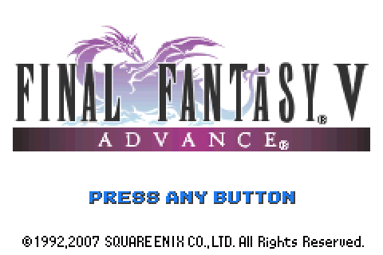
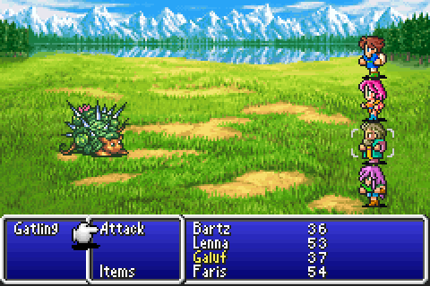
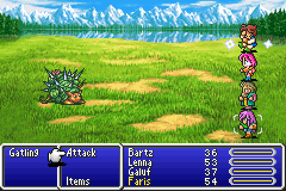
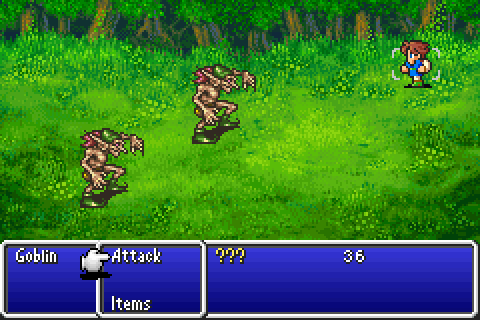

# Final Fantasy V Advance: Classic Rounds

AI-directed by Retch

A patch that turns the battles in **Final Fantasy V Advance** (GBA) into classic, turn-based rounds, like the older Final Fantasy games.

In **Wait** mode, everyone picks what to do first. Then the round plays out, fastest character first. No enemy will ever attack while you are still choosing, and the ATB bars are gone.

Prefer the original? Switch to **Active** mode and the game plays exactly like it always did.

| Wait mode | Active mode |
|---|---|
|  |  |

## How to play

1) Patch your ROM (see below)
2) Start the game and open the menu
3) Go to Config, then Battle Mode
4) Pick Wait for classic rounds, or Active for the original battles

There's no extra switch to find.

## What changes in Wait mode

- Everyone on both sides gets one turn each round
- You pick commands for your party one at a time, and time stays frozen while you think
- Once everyone has picked, the round plays out from fastest to slowest
- Speed comes from the game's own stats, so Agility and lighter gear help you act sooner
- Haste moves you up the order and Slow moves you down
- A preemptive strike gives your party a free first round
- A back attack gives the enemies a free first round
- Quick lets the caster take two turns in a row, then everyone else goes as planned
- Counterattacks still happen right away
- Timed statuses like Stop, Poison, Regen and Doom only tick while actions play out, so they last a little longer than usual

## Download and patch

Get the zip from the [Releases](../../releases) page. It has the patch and a readme. No ROM is included.

1) Use the ROM: Final Fantasy V Advance (Europe) (En,Fr,De,Es,It)
2) Open an IPS patcher such as Floating IPS or Rom Patcher JS
3) Apply the patch file from the zip to your ROM
4) Load the patched ROM in your emulator or flash cart

Make a backup of your ROM and your save before patching.

| | CRC32 |
|---|---|
| Before patching | `7197117E` |
| After patching | `FC53E188` |

## Plays nicely with

- Final Fantasy V Advance Sound Restoration by Bregalad, ipatix and Dwedit (with or without the orchestra intro)
- Final Fantasy V Color Correction and Improvement
- You can apply these patches in any order and get the same result

## Tested

- Regular battles from the start of the game to the end
- Every boss and special battle, including Gilgamesh, Exdeath, Omega and Necrophobe
- Galuf's big story fight against Exdeath
- Jump, Mimic, Hide, Kick, Aim, Flee and running away with L and R
- Stop, Paralyze, Berserk, Confuse, Sleep and Quick
- Preemptive strikes and back attacks
- Together with Sound Restoration and Color Correction

## Special thanks

- altaihero, for asking for a turn-based Final Fantasy Advance and inspiring this patch

## Found a problem?

If a battle ever stops moving or something feels off, please open an [issue](../../issues). Tell us which battle it was and what you picked that round.
